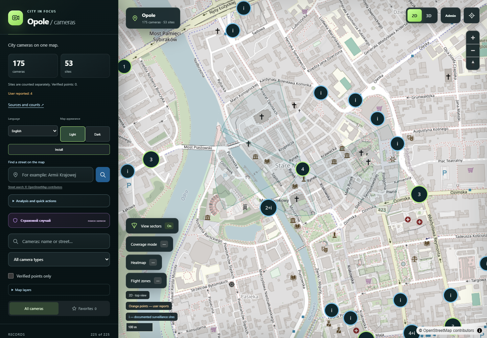
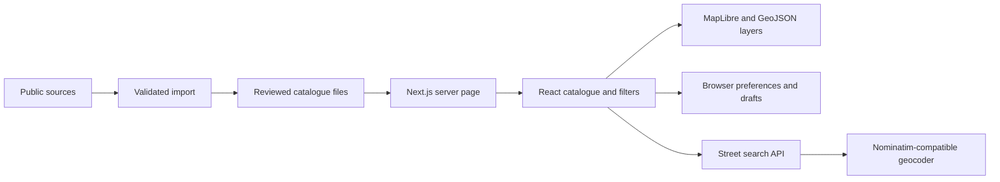

# Opole Camera Map



[Watch the 35-second demo](docs/media/demo.webm)

[Live demo](https://opole-camera-map.vercel.app/) · [Documentation](docs/GUIDE.md) · [Development decisions](docs/DEVELOPMENT.md)

An interactive GIS application for publicly documented cameras and surveillance sites in Opole, Poland, with separately labelled user reports.

## Main features

- Search cameras and highlight named streets on a 2D/3D map.
- Filter source layers, inspect provenance and save favourites.
- Open publisher camera views and public ITS snapshots.
- Analyse a selected area or route and export CSV/GeoJSON.
- Mark an incident and find nearby catalogue entries for a recording enquiry.
- Explore camera density and a reference drone-zone layer.
- Use four interface languages, light/dark maps and an installable mobile app.

## Stack

Next.js · React · TypeScript · MapLibre GL JS · GeoJSON · OpenStreetMap · Node.js tests · Playwright · ESLint · Prettier

## Run locally

Requires Node.js 24+ and pnpm 11.19.0.

```sh
npm install -g pnpm@11.19.0
pnpm install --frozen-lockfile
pnpm dev
```

Open http://localhost:3000. Map tiles and camera sources require internet access.

```sh
pnpm lint
pnpm format:check
pnpm typecheck
pnpm test:coverage
pnpm build
pnpm test:e2e
```

## Architecture



## Data and limitations

The catalogue contains 225 records: 171 individual cameras, one reported group of four cameras, and 53 documented sites. Site-level counts are not added to the camera total. These are catalogue records, not a complete census of operational cameras.

Location and optical verification are separate. No point is promoted to verified merely to fill the filter. Public images do not imply access to recordings. Drone zones and illustrative camera sectors do not establish permission to fly or actual visibility.

The PWA requires internet; offline navigation displays a standalone explanation. Admin drafts and incident work are local to the browser; there is no authenticated multi-user administration backend.

See [the detailed guide](docs/GUIDE.md), [source review](docs/PUBLIC_SOURCE_REVIEW.md), [ITS import](docs/ITS_IMPORT.md), and [development decisions](docs/DEVELOPMENT.md).

## License

Original code and documentation: [MIT](LICENSE), © 2026 Paremik. Third-party data, imagery, tiles and libraries retain their original terms; see source documentation.
